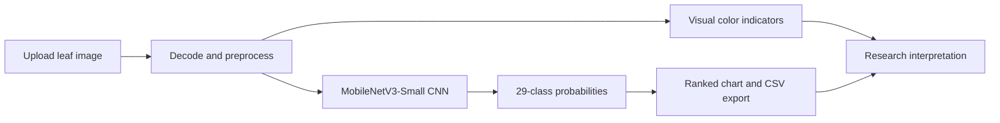

# 🌿 SmartPlant AI
### Lightweight Deep Learning for Plant Leaf Health Research

**From a trained neural network to a live, mobile-friendly research application.** SmartPlant AI combines **MobileNetV3-Small**, interpretable color and texture analysis, and a reproducible evaluation workflow to explore plant-leaf disease classification.

[](https://tinyguard-ai-rhqchfw8wkoqetj3zcwcsd.streamlit.app/)
[](https://www.python.org/)
[](https://pytorch.org/)
[](docs/SMARTPLANT_RESEARCH.md)

**[🚀 Try the live app](https://tinyguard-ai-rhqchfw8wkoqetj3zcwcsd.streamlit.app/)** · **[Research methodology](docs/SMARTPLANT_RESEARCH.md)** · **[Classroom presentation](docs/SMARTPLANT_CLASSROOM.md)**

> **Research prototype, not a certified agricultural diagnostic system.** Model class probabilities are not calibrated diagnostic confidence. A displayed 97.6% probability for one image does **not** establish 97.6% real-world accuracy.


> **Quick discovery:** MobileNetV3 plant leaf research prototype with PyTorch, visual analysis and a Streamlit demo.
>
> **Start here:** [Streamlit demo](https://tinyguard-ai-rhqchfw8wkoqetj3zcwcsd.streamlit.app/) · [Research methodology](docs/SMARTPLANT_RESEARCH.md) · [Contribution guide](CONTRIBUTING.md) · [Report a bug](https://github.com/dapperdude404/tinyguard-ai/issues/new?template=bug_report.yml) · [Discovery & social preview](DISCOVERY_PACK.md).
>
> **Scope:** Research prototype, not a certified agricultural diagnosis. Model class probabilities are not real-world accuracy.

## ✨ What makes SmartPlant AI different?

| Capability | Implementation | Status |
| --- | --- | --- |
| 🧠 CNN classification | MobileNetV3-Small; **29 labeled plant health/disease categories** | **Live inference observed** |
| 📷 Leaf image analysis | Upload JPG, PNG or WEBP images in Streamlit | Available |
| 📊 Explainable visual indicators | Green/yellow/brown pixel percentages, HOG texture and RGB histograms | Available |
| 🏆 Ranked predictions | Top-five CNN class probabilities and interactive bar chart | Available |
| 📥 Export | Download ranked CNN predictions as CSV | Available |
| 🔐 Model integrity | Google Drive checkpoint retrieval, SHA-256 validation and PyTorch `weights_only=True` | Implemented |
| 🌲 Baseline model | Optional Random Forest trained on labeled image folders | Available for local training |
| 🧪 Scientific evaluation | Test guidance, reproducibility notes and methodology | Independent field validation pending |

### See the complete workflow



The CNN uses a **160 × 160** center-cropped image with ImageNet normalization. The app separately reports simple visible color statistics; these are descriptive measurements, **not segmentation or disease severity scores**.

## 🖥️ Live application

**[Open SmartPlant AI](https://tinyguard-ai-rhqchfw8wkoqetj3zcwcsd.streamlit.app/)**

1. Open the **Analyze a leaf** tab and upload a clear photograph of one leaf.
2. Review the green, yellow and brown pixel indicators.
3. Inspect the predicted category and the ranked top-five CNN probabilities.
4. Export the results with **Download CNN predictions**.

For better input photographs, use natural lighting, keep the leaf in focus and avoid cluttered backgrounds. An unfamiliar species, poor lighting or an out-of-distribution image may produce misleading predictions.

## 🏗️ Architecture and model provenance

- **Interface:** Python + Streamlit + Plotly.
- **CNN:** PyTorch / torchvision MobileNetV3-Small, with 29 classifier outputs.
- **Checkpoint:** `best_model_safe.pt`, hosted on Google Drive and downloaded at runtime when required. The repository does **not** contain the complete trained CNN binary.
- **Checkpoint integrity:** A pinned SHA-256 digest is verified before the model is loaded with `weights_only=True`.
- **Additional analysis:** Image preprocessing, color statistics, HOG features and RGB histograms.
- **Optional classical baseline:** Random Forest training through `train.py`.

Model download configuration: [`smartplant/model_download.py`](smartplant/model_download.py). CNN loading and inference: [`smartplant/cnn.py`](smartplant/cnn.py).

**Important:** The checkpoint is shared publicly via a link. Do not replace it with an unverified artifact, and do not disable PyTorch safe loading.

## ⚙️ Run locally

Recommended: **Python 3.11**.

```bash
git clone https://github.com/dapperdude404/tinyguard-ai.git
cd tinyguard-ai
python -m venv .venv
# Activate the virtual environment for your operating system
pip install -r requirements.txt
streamlit run app.py
```

Open the local Streamlit URL and upload a leaf image. The first CNN request may download the checkpoint; subsequent requests reuse the installed verified file.

To verify the checkpoint independently:

```bash
python -c "from smartplant.model_download import ensure_cnn_checkpoint; print(ensure_cnn_checkpoint('models/smartplant_mobilenetv3.pt'))"
python scripts/check_cnn_checkpoint.py
```

The second command checks loading and synthetic-image inference; **it is not an accuracy benchmark**.

## 🌱 Optional Random Forest baseline

For comparative experiments, organize labeled images as follows:

```text
data/train/
  Healthy/
    leaf_001.jpg
  Tomato_Early_blight/
    leaf_002.jpg
  Tomato_Late_blight/
    leaf_003.jpg
```

Train a separate classical model:

```bash
python train.py --data data/train --output models/plant_model.joblib
```

This produces `models/plant_model.joblib` and metrics JSON. The classical baseline is separate from the deployed 29-class CNN. Five images per class may satisfy a basic training-script minimum but are **not sufficient evidence of scientific generalization**.

## 🧪 Tests and scientific rigor

```bash
pip install -r requirements-dev.txt
python -m pytest -q
```

For meaningful disease-classification evaluation, use an **independent, plant- or farm-aware test set**, remove near-duplicate images across splits and report per-class precision, recall, macro F1, confusion matrices and failure cases. A previously reported high test-set score must not be treated as independently verified field performance, especially while potential cross-split duplicates remain unresolved.

The live screenshot demonstrates that CNN inference and visualization work. It does **not** establish agronomic accuracy, robustness to unseen farms or calibrated probabilities.

## 🧬 Experimental 50-class CNN expansion (not yet trained)

A separate development workflow proposes retaining the **original 29** classes and adding **21 crop/health categories** for **Mango, Guava, Banana, Rice, Wheat, Citrus, Maize and Papaya**. It includes a SHA-pinned MobileNetV3-Small warm-start training script, strict dataset audits, macro-F1 test reporting, and dynamic ONNX / Android / Streamlit label support.

**This is a development pipeline, not an available 50-class disease classifier.** A real licensed dataset, training, independent evaluation, new model checksum, and on-device validation are required. The default production model remains the verified 29-class CNN.

See [50-class training, evaluation and deployment gates](docs/SMARTPLANT_50_CLASS_EXPANSION.md).

## 🚀 Deploy

Deploy with [Streamlit Community Cloud](https://share.streamlit.io):

| Setting | Value |
| --- | --- |
| Repository | `dapperdude404/tinyguard-ai` |
| Branch | `main` |
| Main file | `app.py` |

After deployment, upload a leaf photo and verify the model loads, a ranked prediction appears and CSV export works. If a checkpoint error occurs, review **Manage app → Logs** and verify the public Drive permissions and pinned SHA-256 value.

## 🔬 Research roadmap

These are **proposed enhancements, not currently implemented features**:

- **Field validation:** Collect independent real-world leaf photographs from multiple locations, plants and lighting conditions.
- **Uncertainty and abstention:** Calibrate probabilities and flag low-confidence or out-of-distribution images.
- **Explainability:** Add Grad-CAM heatmaps to investigate the visual evidence behind predictions.
- **Model comparison:** Benchmark MobileNetV3 against EfficientNet and classical feature-based baselines.
- **Edge AI:** Evaluate quantization, ONNX/TFLite export and offline Android inference.
- **Responsible data practices:** Add dataset provenance, license records, model cards and drift monitoring.

## 📚 Academic resources

- [Research methodology](docs/SMARTPLANT_RESEARCH.md)
- [Classroom presentation script](docs/SMARTPLANT_CLASSROOM.md)
- [CNN deployment notes](docs/CNN_MODEL_DEPLOYMENT.md)
- [Checkpoint recovery notes](docs/CNN_CHECKPOINT_RECOVERY.md)
- [Original TinyGuard anomaly-detection project — preserved](https://github.com/dapperdude404/tinyguard-ai/tree/archive/tinyguard-anomaly-v1)

## ⚖️ Responsible use

SmartPlant AI is an **M.Tech AI research and educational prototype**. It does not diagnose disease with certified accuracy, prescribe pesticides or replace local agronomy expertise. Use results as hypotheses for further inspection, not as the sole basis for crop-management decisions.

---

**SmartPlant AI · M.Tech Artificial Intelligence Research Edition**  
*Making lightweight plant-image AI more accessible, interpretable and reproducible.*
